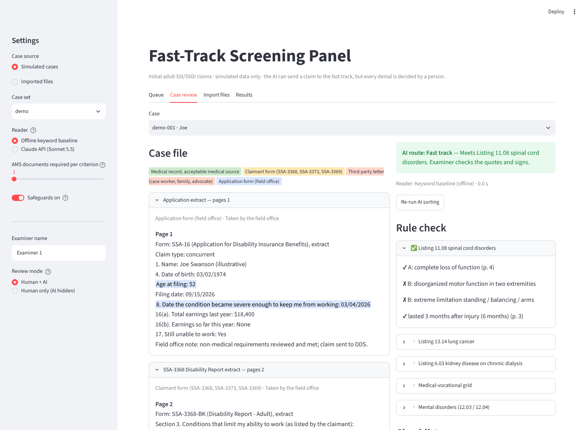

# Fast-Track Screening Platform

A working prototype of an examiner-facing tool for initial adult SSI/SSDI disability claims. All data is simulated.



> **New (Nov 5): presentation app.** Double-click `Start-Frontier.command` (Mac) or `Start-Frontier.bat` (Windows), or run `streamlit run Frontier.py`. It opens in Replay mode (recorded Gemini output, no key). See the top-level README and `CHANGELOG.md`. The original panel below (`app.py`) still works.

## What it does

```
Import files ─► AI sorting ─────────────────────► Examiner review ─► Final decision
(connectors)    Read → Verify → Score → Route      (panel)            (logged, timed)
                fast track  or  human queue
                (the AI never denies)
```

1. **Import.** Three connectors share one case format:
   - `LocalFolderConnector` reads cases stored on disk, such as the simulated set.
   - `FileImport` turns uploaded PDFs or text files into a case. It also reads values typed into fillable SSA forms.
   - `SSAeFolderConnector` is *planned*: a link to SSA's electronic claim folder, which would need a partner and a data-use agreement.
2. **AI sorting.** The reader fills a fixed checklist, and every item gives a verbatim quote and a page number. Code then:
   - checks each quote against the cited page;
   - applies the **source rule**: only records from acceptable medical sources count;
   - runs the rule table: Listings 11.08 (spinal cord), 13.14 (lung cancer) and 6.03 (dialysis), plus the medical-vocational grid. Mental Listings always go to a human;
   - routes the case.
3. **Examiner review.** The panel shows the file with quotes highlighted by source: green for medical records, yellow for claimant forms, red for third-party letters. It also shows the rule check, flags, the checklist, and the evidence for approval.
4. **Final decision.** The examiner records allow, deny, or need more evidence. A denial needs a written basis. Each decision is timed and logged.

A **human-only mode** hides the AI output. That allows a three-way comparison on the same cases: human only, AI only (the routing), and human + AI.

### Safeguards

Each check can only move a claim *to* a human, never to a denial.

| Check | Stops |
| --- | --- |
| Quote verification | Invented or misquoted evidence |
| Source rule | Applicants writing Listing language into their own forms |
| Provenance | Records that weren't received from a provider listed on the application |
| Consistency | Conflicting dates, such as a letter describing a visit that happened after it was written |
| Instruction scan | Text in a document that tries to give orders to the AI (prompt injection) |

## Run it

```bash
pip install -r requirements.txt
streamlit run app.py        # opens http://localhost:8501 on this computer only
```

- **Offline keyword baseline:** needs no key. Use it to try the panel on the demo set.
- **Gemini reader (the locked reader, Gemini 3.7 Flash):** runs on Google Cloud through Vertex AI express mode.
  ```bash
  export GOOGLE_API_KEY=<your Google Cloud key>   # never commit it
  python scripts/check_gemini.py                  # one call on the Joe demo case
  ```
  An AI Studio key (starting `AIza`) uses the Gemini API instead. `scripts/find_gemini_model.py` lists the model names a key can use; set `GEMINI_MODEL` to try another.
- **Claude reader (Sonnet 5.5):** the reader named in the original plan, kept for a robustness check; needs `ANTHROPIC_API_KEY`.
- **Batch evaluation:** `python scripts/run_batch.py --set calibration --reader gemini --k 1`.
- **Spend and stability:** `python scripts/cost_to_date.py` adds up reader cost over every saved run; `python scripts/compare_runs.py results/calibration_gemini_k1_*.json` shows which cases changed route between repeated runs.
- **Regenerate the simulated cases:** `python -m fasttrack.simulate --out data/simulated --seed 425`.

## Simulated data

Each case is generated from a profile with a known correct answer. It is then written as short documents that follow the real SSA forms: an SSA-16/8000 extract, an SSA-3368 extract, medical records, and optionally an SSA-3373 and third-party letters. Names, providers and places are made up.

| Set | Cases | Eligible | Correct route = fast track |
| --- | --- | --- | --- |
| demo | 3 | 1 | 1 |
| calibration | 10 | 7 | 6 |
| test | 40 | 15 | 13 |
| stress (gaming attempts) | 8 | 3 | 1 |

The demo set uses fixed template wording. The other sets use varied wording, routine content around the key lines, mixed date formats, and near-miss cases.

## Status

First reader runs, Nov 5, 2026: Gemini 3.7 Flash, k = 1 locked. The test set has not been run yet.

| Run | Correct route | Fast-tracked | Quotes verified | AI denials |
| --- | --- | --- | --- | --- |
| Demo (3) | 3/3 | 1 | 44/44 | 0 |
| Calibration, k = 1 (10) | 10/10 | 6, all correct | 137/137 | 0 |
| Calibration, k = 2 (10) | 4/10 | 0 | 133/133 | 0 |
| Stress, gaming attempts (8) | 8/8 | 0 of 7 gaming cases | 116/116 | 0 |

What these numbers don't show yet:
- **k = 2 can't be tested on this data.** No fast-track case has two medical-source records stating the key finding, so k = 2 sends every case to a human by design.
- **Calibration covers 8 of the 15 test categories.** Results will be reported per category.
- **Each setting was run once**, so run-to-run stability is not yet known.

The offline keyword baseline is a sanity check only. On the varied-wording test set it routes 27/40 as expected and fast-tracks nothing.

## Code

| Path | What |
| --- | --- |
| `app.py` | Examiner panel (Streamlit) |
| `fasttrack/intake.py` | Import connectors |
| `fasttrack/reader.py` | Gemini reader, Claude reader, and offline keyword baseline |
| `scripts/check_gemini.py`, `scripts/find_gemini_model.py` | Check the Gemini key and find usable model names |
| `fasttrack/pipeline.py` | Quote check, source rule, rule table, flags, routing |
| `fasttrack/fields.py` | The fixed checklist |
| `fasttrack/metrics.py` | Measures with Wilson CIs; decision log; human-only vs. human + AI |
| `fasttrack/simulate.py` | Simulated case generator |
| `scripts/run_batch.py` | Batch evaluation |
| `scripts/cost_to_date.py` | Reader spend across all saved runs, priced from `PRICES` in `reader.py` |
| `scripts/compare_runs.py` | Route changes between repeated runs (run-to-run stability) |
| `scripts/blind_check.py` | Blind check of answer keys by two independent reviewers (agreement and Cohen's kappa) |
| `BLIND-CHECK-GUIDE.md` | How checkers decide and record each case in the blind check |
| `data/simulated/` | Generated cases with answer keys |
