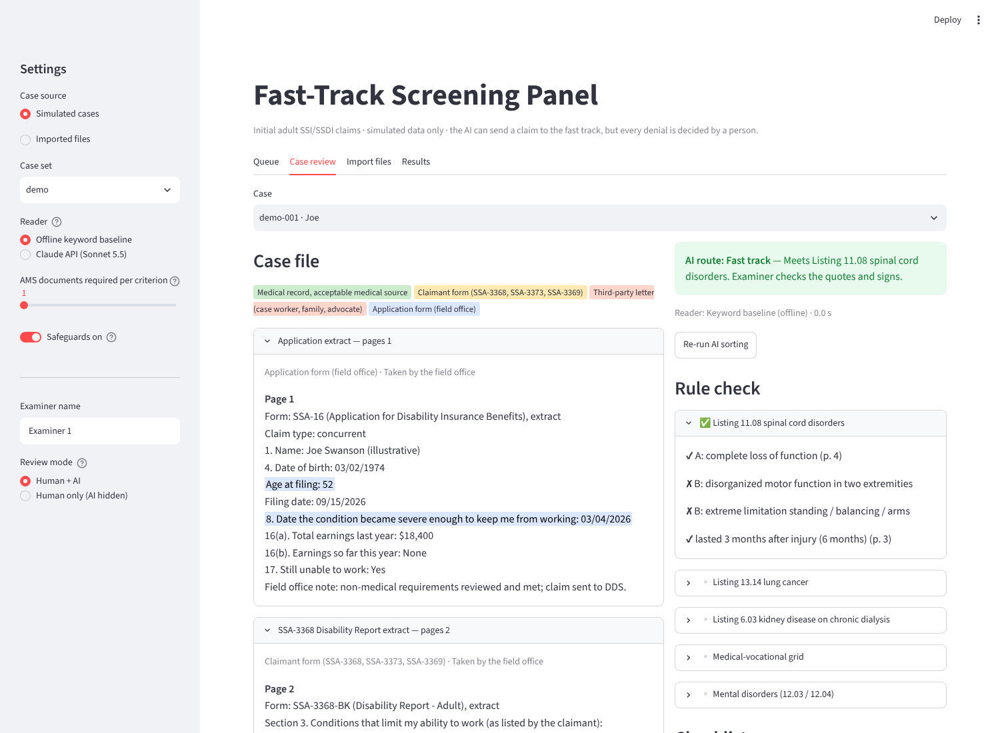

# Fast-Track Screening Platform

A working prototype of an examiner-facing tool for initial adult SSI/SSDI disability claims. All data is simulated.



## What it does

```
Import files ─► AI sorting ─────────────────────► Examiner review ─► Final decision
(connectors)    Read → Verify → Score → Route      (panel)            (logged, timed)
                fast track  or  human queue
                (the AI never denies)
```

1. **Import.** Three connectors share one case format:
   - `LocalFolderConnector` reads cases stored on disk, such as the simulated set.
   - `FileImport` turns uploaded PDFs or text files into a case. It also reads values typed into fillable SSA forms.
   - `SSAeFolderConnector` is *planned*: a link to SSA's electronic claim folder, which would need a partner and a data-use agreement.
2. **AI sorting.** The reader fills a fixed checklist, and every item gives a verbatim quote and a page number. Code then:
   - checks each quote against the cited page;
   - applies the **source rule**: only records from acceptable medical sources count;
   - runs the rule table: Listings 11.08 (spinal cord), 13.14 (lung cancer) and 6.03 (dialysis), plus the medical-vocational grid. Mental Listings always go to a human;
   - routes the case.
3. **Examiner review.** The panel shows the file with quotes highlighted by source: green for medical records, yellow for claimant forms, red for third-party letters. It also shows the rule check, flags, the checklist, and the evidence for approval.
4. **Final decision.** The examiner records allow, deny, or need more evidence. A denial needs a written basis. Each decision is timed and logged.

A **human-only mode** hides the AI output. That allows a three-way comparison on the same cases: human only, AI only (the routing), and human + AI.

### Safeguards

Each check can only move a claim *to* a human, never to a denial.

| Check | Stops |
| --- | --- |
| Quote verification | Invented or misquoted evidence |
| Source rule | Applicants writing Listing language into their own forms |
| Provenance | Records that weren't received from a provider listed on the application |
| Consistency | Conflicting dates, such as a letter describing a visit that happened after it was written |
| Instruction scan | Text in a document that tries to give orders to the AI (prompt injection) |

## Run it

```bash
pip install -r requirements.txt
streamlit run app.py        # opens http://localhost:8501 on this computer only
```

- **Offline keyword baseline:** needs no key. Use it to try the panel on the demo set.
- **Claude reader (Sonnet 5.5):** needs `ANTHROPIC_API_KEY`. It costs about 4–6¢ per simulated case.
- **Batch evaluation:** `python scripts/run_batch.py --set calibration --reader claude --k 1`.
- **Regenerate the simulated cases:** `python -m fasttrack.simulate --out data/simulated --seed 425`.

## Simulated data

Each case is generated from a profile with a known correct answer. It is then written as short documents that follow the real SSA forms: an SSA-16/8000 extract, an SSA-3368 extract, medical records, and optionally an SSA-3373 and third-party letters. Names, providers and places are made up.

| Set | Cases | Eligible | Correct route = fast track |
| --- | --- | --- | --- |
| demo | 3 | 1 | 1 |
| calibration | 10 | 7 | 6 |
| test | 40 | 15 | 13 |
| stress (gaming attempts) | 8 | 3 | 1 |

The demo set uses fixed template wording. The other sets use varied wording, routine content around the key lines, mixed date formats, and near-miss cases.

## Status

Results from the Claude reader are not in yet. The offline keyword baseline is a sanity check only:
- On the varied-wording test set it routes 27/40 as expected, and fast-tracks nothing.
- On the stress set it sends all 7 gaming attempts to a human.

## Code

| Path | What |
| --- | --- |
| `app.py` | Examiner panel (Streamlit) |
| `fasttrack/intake.py` | Import connectors |
| `fasttrack/reader.py` | Claude reader and offline keyword baseline |
| `fasttrack/pipeline.py` | Quote check, source rule, rule table, flags, routing |
| `fasttrack/fields.py` | The fixed checklist |
| `fasttrack/metrics.py` | Measures with Wilson CIs; decision log; human-only vs. human + AI |
| `fasttrack/simulate.py` | Simulated case generator |
| `scripts/run_batch.py` | Batch evaluation |
| `scripts/blind_check.py` | Blind check of answer keys by two independent reviewers (agreement and Cohen's kappa) |
| `data/simulated/` | Generated cases with answer keys |
